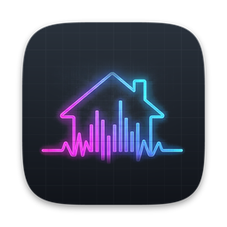

<p align="center">
  
</p>

<h1 align="center">InHaus EQ</h1>

<p align="center">A system-wide equalizer for macOS that lives in your menu bar.</p>

---

## Features

- **EQ for everything your Mac plays.** Music, video, games, browser tabs, all through one 10-band EQ (±12 dB per band) with a preamp. No virtual audio driver to install.
- **Live spectrum analyzer.** Watch what's playing before and after the EQ, drawn right behind the EQ curve. The menu bar icon can show a live meter too.
- **Headphone correction from AutoEQ.** Search thousands of headphones and IEMs and apply a correction profile in one click, or load your own `ParametricEQ.txt`.
- **Every output keeps its own settings.** Speakers, headphones, AirPods and DACs each remember their EQ, and InHaus EQ switches automatically when you change outputs.
- **Volume past 100%.** Boost up to 400%, with a soft limiter that keeps loud peaks from crackling.
- **Per-app volume.** Turn any app that's playing down to 0% or up to 200%.
- **Sample-rate control.** Set your output's sample rate (up to 192 kHz on devices that support it) from the menu bar.
- **Stays out of the way.** Menu bar only, no Dock icon, optional launch at login.

## Requirements

- macOS 14.2 (Sonoma) or later
- Apple Silicon or Intel Mac

## Install

1. Download the latest `InHaus-EQ-x.x.dmg` from [Releases](../../releases).
2. Open it and drag **InHaus EQ** into **Applications**.
3. Open InHaus EQ from Applications. macOS will say it can't verify the app, because InHaus EQ comes from an independent developer and isn't notarized by Apple. Click **Done**.
4. Open **System Settings → Privacy & Security**, scroll down to **Security**, and click **Open Anyway** next to InHaus EQ. You only do this once.
5. When InHaus EQ asks to record system audio, click **Allow**. That's how the EQ reaches your audio. Nothing is recorded or saved.

Then look for the InHaus EQ icon in your menu bar.

## How it works

InHaus EQ uses Core Audio process taps (added in macOS 14.2) to pick up what your apps are playing, runs it through biquad filters written in C on the real-time audio thread, and plays the result on your output device. Since there's no virtual audio driver, there's nothing to uninstall except the app itself.

## Known limitations

- **AirPods automatic switching** between your Apple devices doesn't happen while the EQ is running. This is true of tap-based EQs in general.
- **Calls are left alone.** Apps using the microphone (FaceTime, Zoom, Discord) skip the EQ so calls sound normal.
- **Per-app volume** takes about a second to kick in when an app relaunches.
- **Sample rates** are limited to what your output device supports. Bluetooth headphones are usually fixed at one rate.

## Building from source

Requires Xcode 26 or later.

1. Clone this repository and open `InHausEQ.xcodeproj`.
2. Under **Signing & Capabilities**, choose your team (a free Personal Team works).
3. Press **⌘R**.

To make a release `.dmg`, run:

```bash
bash Scripts/make-release.sh
```

The disk image is saved to `dist/`.

### Project layout

| Folder | What's in it |
| --- | --- |
| `InHausEQ/DSP` | EQ filters, limiter and spectrum analyzer (C) |
| `InHausEQ/Audio` | Process taps, output devices, per-app volume, permissions |
| `InHausEQ/Model` | EQ settings, per-device profiles, AutoEQ search and parser |
| `InHausEQ/UI` | Menu bar panel, equalizer window, welcome window |
| `Scripts` | Release packaging |

## Uninstall

Quit InHaus EQ (the Quit button at the bottom of its menu bar panel) and drag it from Applications to the Trash. To remove its settings too, delete:

- `~/Library/Application Support/InHausEQ`
- `~/Library/Preferences/com.inhausrepair.eq.plist`

## Credits

Headphone corrections come from [AutoEQ](https://github.com/jaakkopasanen/AutoEq) by Jaakko Pasanen (MIT License), built from measurements by oratory1990, crinacle, Rtings and others credited in that project.

---

© 2026 Peyton Gibbs
